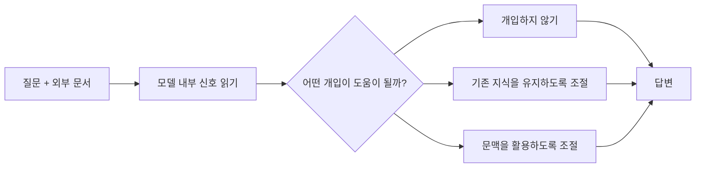

# Alltology
## 기억과 문서가 다를 때, LLM은 무엇을 믿어야 할까?

**틀린 문서에 흔들리는 답은 줄이고, 맞는 문서로 답하던 능력은 지키는 선택적 개입 연구**

2026 이화여자대학교 캡스톤디자인 · 03팀 · 연구 트랙 · 지도교수 황의원

[처음 오셨나요?](docs/getting_started.md) · [연구 활동과 산출물](docs/review_guide.md) · [프로젝트 소개](docs/project_brief.md) · [코드](experiments/README.md) · [결과와 한계](docs/research_status.md)

## 왜 필요한가?

검색한 문서가 틀릴 수도 있고, 모델이 기억한 정보가 틀릴 수도 있습니다.
책을 펼쳐 놓고 문제를 풀 때 **책만 믿는 것과 기억만 믿는 것 모두 위험한 상황**과 비슷합니다.

| 상황 | 필요한 판단 |
|---|---|
| 모델은 정답을 알지만 문서가 잘못된 답을 제시함 | 문서에 끌려가던 답변을 바로잡기 |
| 모델은 답을 모르지만 문서에 올바른 답이 있음 | 문서로 맞히던 답변을 불필요한 개입으로 망치지 않기 |

따라서 목표는 무조건 모델의 기억을 강화하는 것이 아니라, **입력마다 개입이 필요한지와 어떤 개입이 도움이 되는지 판단하는 것**입니다. 두 정보원 모두 틀린 경우에는 어느 하나를 고르는 것만으로 정답이 보장되지 않습니다.

## 무엇을 연구하는가?

현재 중심은 **Routing: 내부 신호를 보고 개입 여부·방향·강도를 선택하는 방법**입니다.
어텐션 헤드 등에서 내부 신호를 분석하고, 모델 가중치를 고정한 채 내부 활성값을 조절하는 Steering과 연결합니다.

그림은 행동 선택의 개념도입니다. 평가용 정답을 추론 중 직접 제공한다는 뜻은 아닙니다.

| 구성 | 쉬운 설명 | 현재 위치 |
|---|---|---|
| **Steering** | 답변 생성 과정에 방향을 주는 조절 수단 | 모든 입력에 같은 조절을 하는 Always 방식이 비교 기준 |
| **Routing** | 조절할지, 어느 방향·강도로 조절할지 선택 | 행동별 이득 예측·외부 평가, 온라인 선택 고도화 |
| **Packed** | 문서를 본 경우와 보지 않은 경우의 답변 분기를 비교 | 두 구간을 한 입력 처리 호출에 담는 별도 경로·선택 규칙 분석 |

**Routing과 Packed를 합친 최종 방법은 아직 검증하지 않았습니다.** 상태를 잘 분류하는 것과 실제 답을 개선하는 것도 다릅니다. 용어·구현 구분은 [처음 읽는 안내](docs/getting_started.md)에 정리했습니다.

## 어디부터 보면 되나요?

| 방문 목적 | 읽는 순서 |
|---|---|
| 처음 프로젝트를 이해하기 | [짧은 소개](docs/project_brief.md) → [방법·용어·첫 결과](docs/getting_started.md) |
| 교수님·심사위원이 활동 확인하기 | [활동→결정→산출물](docs/review_guide.md) → [회의록](docs/README.md#회의와-원문-자료) → [팀원별 근거](docs/team_contributions.md) |
| 코드와 결과 확인하기 | [실험별 코드 지도](experiments/README.md) → [A1 저장 결과](experiments/A1/%5Bresult%5DA1_staged_routing/A1_policies.csv) → [평가 조건과 한계](docs/research_status.md) |
| 팀에 새로 참여하기 | [참여·재현 시작](docs/getting_started.md#새-참여자의-작업-순서) → [다음 연구](docs/research_plan.md) → [기여 규칙](CONTRIBUTING.md) |

## 무엇을 확인했는가?

아래는 기존 산출물·팀 보고 기준이며, 이번 저장소 정리에서 모델을 재실행하지 않았습니다.

| 근거 | 관찰 | 해석 범위 |
|---|---|---|
| P8S의 [A1 저장 결과](experiments/A1/%5Bresult%5DA1_staged_routing/A1_summary.json) | Router가 Always보다 높은 점수지만 유의한 차이는 미검출 | 저장 행동 결과를 이용한 정책 평가; 온라인 속도 측정이 아님 |
| ConFiQA 외부 [Router 보고](docs/research_status.md#3-외부-평가-routing과-packed) | 개입 전 정답률 51.65% → Router 55.45%; 올바른 문맥의 성능 저하가 사전 허용 범위를 넘지 않는 기준 충족 | 1,000질문; 대상 데이터 학습 fold의 정답으로 Router 학습 |
| ConFiQA·NQ-Swap의 [Packed 보고](docs/research_status.md#3-외부-평가-routing과-packed) | 전체 정답률은 개선됐지만 올바른 문맥을 버리는 손상 발생 | 대상 라벨 없이 평가; Router보다 우수하다는 결론은 미확인 |

다음 과제는 **선택 근거와 실패 원인 분석, 외부 검증 확대, 구성 요소 비교, 추론 비용 확인**입니다. [구체적인 연구 질문 →](docs/research_plan.md)

## 코드와 공개 범위

- [현재 실험](experiments/README.md): A0/A1 행동 선택, A3 외부 평가, E17 Packed, P9 Steering 등
- [발표·선행 실험](experiments/presentation/README.md): 내부 신호 분석과 온라인 개입의 연구 경과
- [기존 방법 비교](SOTA/README.md): 비교 하네스 개발 초안; 실행 구조·미구현 방법 확인 필요
- [공용 프롬프트·채점](prompt/p8s_prompt.py): 실험 간 비교 조건
- [이전 연구 보관함](docs/archive/README.md): 초기 RAG·DPO/LoRA 구상·데모·자체점검 기록

현재 연구는 노트북과 저장 결과 중심입니다. 루트 `requirements.txt`·`Makefile`·`src/`는 **초기 RAG 구현용**이며, 최신 연구 전체를 한 번에 실행하는 환경은 아닙니다. 설치보다 먼저 [실행 전제](experiments/README.md#실행에-필요한-입력)를 확인하세요.

## 별도 학술 성과와 팀

내부 신호 분석에서 도출한 **지식–문맥 4-state 판독 연구는 [2026 한국소프트웨어종합학술대회(KSC 2026)](https://www.kiise.or.kr/conference/KSC/2026/)에 투고하여 심사 중**입니다. 현재 Routing·Packed 연구 전체의 채택을 뜻하지 않으며, 논문용 코드·상세 결과는 공개 보류 상태입니다.

박세령 ([@ryeong03](https://github.com/ryeong03)) · 손현경 ([@bbberylll](https://github.com/bbberylll)) · 이다영 ([@dev-ldy03](https://github.com/dev-ldy03))

[팀 활동 근거](docs/team_contributions.md) · [전체 문서](docs/README.md) · [AI 활용 범위](docs/ai_transparency_report.md) · [기여 안내](CONTRIBUTING.md) · [MIT License](LICENSE)

> 문서 업데이트: 2026-10-29 · 연구 기록: 10/27 서면 보고까지. [연구 활동과 주요 산출물](docs/review_guide.md)에서 전체 흐름을 볼 수 있습니다.
