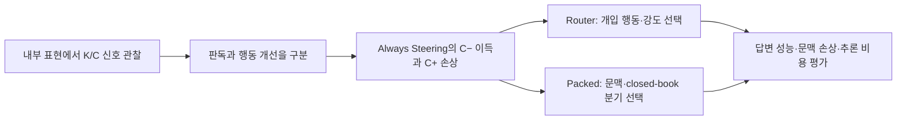

<div align="center">

# Alltology
## 기억과 문맥이 다를 때, 무엇을 믿어야 할까?

**LLM 내부 신호로 지식–문맥 상태를 읽고, 필요한 경우에만 응답에 개입하는 연구**

2026 이화여자대학교 캡스톤디자인 · 03팀 · 연구 트랙 · 지도교수 황의원

[연구 결과](docs/research_status.md) · [실험 코드](experiments/README.md) · [연구 계획](docs/research_plan.md) · [회의록](docs/meeting-log/) · [기여 안내](CONTRIBUTING.md)

</div>

---

> **업데이트: 2026-10-27.** 10월 15일의 Routing 중심 방향을 바탕으로, 10월 27일 서면 보고와 새로 등록된 실험 코드를 반영했습니다. 아래 수치는 제공된 논문·실험 보고 및 저장된 산출물 기준이며, 이번 문서 정리에서 모델 실험을 다시 수행한 결과는 아닙니다.

## 우리가 풀려는 문제

외부 문맥이 모델의 기존 지식과 다른 답을 제시할 때, 문맥을 항상 믿어도, 기억을 항상 고집해도 오답이 생깁니다. 우리는 **두 정보원의 상태를 내부 표현에서 읽을 수 있는지**, 그리고 **그 신호가 실제로 더 나은 답변 선택에 도움이 되는지**를 나누어 연구합니다.

| | C+: 정답을 포함한 문맥 | C−: 답을 잘못 치환한 문맥 |
|---|---|---|
| **K+: 문맥 없는 응답이 정답** | 두 정보원 모두 정답 | 기존 지식을 유지할 필요 |
| **K−: 문맥 없는 응답이 오답** | 올바른 문맥을 활용할 필요 | 두 정보원 모두 오답; 어느 쪽도 정답을 보장하지 않음 |

K는 관측한 closed-book 응답의 정오입니다. K−가 관련 지식의 완전한 부재를 뜻하지는 않습니다.

## 두 연구 축

### 1. 판독 — 지식–문맥 4-state

답변 생성 전 Llama-3.1-8B-Instruct의 **attention head 표현**에서 K/C 상태를 읽습니다. 역할별로 헤드를 선택하고 그 벡터를 연결해 선형 판독기를 학습합니다.

제공된 심사용 논문의 평가 A에서는 PopQA 기반 **612질문·1,224입력** 중 122질문으로 헤드 선택·판독기를 학습하고 490질문에서 평가했습니다.

| 지표 | 보고값 |
|---|---:|
| 4-state Macro-F1, 5회 평균 ± 표준편차 | **0.6123 ± 0.0121** |
| K / C AUROC | **0.8134 / 0.9200** |
| 선택 헤드 / 전체 헤드 | **7–10 / 32** |

이 수치는 **상태 판독 성능**이며 답변 정확도가 아닙니다. 20% 라벨은 고정된 설계 아래의 선별·학습 예산이고, 앞선 설계 탐색까지 포함한 총 라벨 사용량은 아닙니다. 논문은 10월 15일 기록 기준 **심사용 제출 완료**입니다. [평가 조건과 한계 →](docs/research_status.md#1-지식문맥-4-state-판독)

### 2. 제어 — Always Steering → Routing / Packed

관찰에서 방법으로 이어지는 흐름입니다.



| 방법 | 선택하는 것 | 학습·추론 조건 | 현재 관찰 |
|---|---|---|---|
| **Always Steering** | 모든 입력에 같은 retain 방향·강도 | P8S에서 추정한 방향을 고정 | C− 개선이 외부로 전이되지만 C+ 손상 발생 |
| **Routing** | `no-op`, `retain`, `accept`와 강도 | L13 내부 신호로 행동별 이득 예측; 학습 라벨 사용 | ConFiQA에서 전체 개선과 C+ 비열등을 함께 충족 |
| **Packed** | 문맥 A / closed-book B 중 답변 분기 | 격리된 두 구간을 한 prefill 호출로 처리; X1 선택·온라인 방향 추정 | 외부 EM 개선, 하지만 K−C+ 손상과 선택 규칙의 한계 |

**Router의 행동 선택과 packed의 분기 선택은 서로 다른 구성 요소입니다.** 결합 모델의 성능은 아직 확인하지 않았습니다. Packed의 호출 1회는 단일 문맥 입력과 동일 계산량을 뜻하지 않습니다.

### 외부 평가: ConFiQA-QA

1,000질문·2,000입력, C± 모두 **원래 사실 정답**으로 채점한 10월 27일 보고입니다. EM은 %, 변화는 %p입니다.

| 방법 | 전체 EM | Base 대비 ΔEM [95% CI] | C+ ΔEM | C− ΔEM | C+ 비열등 |
|---|---:|---:|---:|---:|---|
| Base | 51.65 | — | — | — | — |
| Always, ρ=0.06 | 54.30 | +2.65 [1.35, 3.90] | −2.90 | +8.20 | 미충족 |
| Router | 55.45 | +3.80 [2.70, 5.05] | +0.80 | +6.80 | 충족 |
| Packed | 55.80 | +4.15 [2.52, 5.90] | −7.60 | +15.90 | 미충족 |

Router는 **ConFiQA train fold의 정답으로 학습**했고, packed는 대상 데이터 라벨을 사용하지 않았습니다. Packed의 Router 대비 +0.35%p는 신뢰구간이 0을 포함해 우위가 확인되지 않았습니다. 비열등은 C+ ΔEM의 95% 신뢰구간 하한 > −2%p 기준입니다. [출처·NQ-Swap·P8S 결과와 비교 범위 →](docs/research_status.md)

## 코드와 결과 찾아보기

| 목적 | 시작할 곳 |
|---|---|
| 현재 방법과 공개 범위 파악 | [실험 안내](experiments/README.md) |
| 프롬프트 편향·라벨·레이어 신호 | [E0](experiments/E0/) · [E1](experiments/E1/) · [E2](experiments/E2/) · [P8S probe](experiments/p8s_probe/) |
| Steering의 발전과 재현성 검증 | [P9](experiments/P9/) · [Steering_retain](experiments/Steering_retain/) · [E15](experiments/E15/) |
| 행동별 이득과 조건부 Routing | [A0](experiments/A0/) · [A1](experiments/A1/) — CSV·Parquet 결과 포함 |
| 외부 전이·강도·문맥 오류 비율 | [A3](experiments/A3/) |
| C+ 손상 진단·Packed | [E17](experiments/E17/) |
| 기존 방법 비교 코드 | [SOTA 안내](SOTA/README.md) — 하네스 초안·구현 상태 확인 |
| 공용 프롬프트와 채점 | [p8s_prompt.py](prompt/p8s_prompt.py) |
| 연구 근거·논문 결과·원문 위치 | [연구 결과 및 근거](docs/research_status.md) |

## 재현 시작하기

```bash
git clone https://github.com/Ontology0/Graduation-Project.git
cd Graduation-Project
```

현재 연구는 Colab/Jupyter 노트북과 저장된 산출물을 중심으로 구성됩니다. **실험 안내에서 입력 데이터·선행 산출물·환경을 확인한 뒤 해당 노트북을 실행하세요.**

- P8S 원본·hidden cache·P9 manifest 등 일부 입력은 별도 공유 자료입니다.
- 모델 추론·steering에는 모델 접근 권한과 GPU가 필요합니다. E2·A1 등은 선행 산출물이 준비되면 CPU 분석이 가능합니다.
- 공용 규격은 `p8s-v2`, 생성 길이는 192입니다. 과거 노트북의 설정·라벨 버전·레이어 번호와 섞어 비교하지 않습니다.
- `SOTA/dayoung/`은 비교 코드 초안입니다. 현재 파일 배치와 `common/`·`methods/` import 구조가 일치하지 않아 바로 실행 가능한 패키지는 아닙니다.
- 루트 `requirements.txt`·`Makefile`·`src/`는 초기 RAG 구현용이며 최신 실험 전체의 통합 실행 환경이 아닙니다.

## 다음 연구

1. **Router 고도화:** NQ-Swap 평가 확대, 내부 신호·행동 집합·강도 선택 근거 분석
2. **Packed 선택 규칙 개선:** X1이 K−C+에서 잘못된 기억을 고르는 원인 검증
3. **구성 요소 비교:** Always / Router / Packed를 분리하고 결합 효과는 별도 실험
4. **공정한 비교:** 동일 질문·프롬프트·채점의 기준선, 개발·평가 분리, 성능과 비용 보고
5. **재현성 정리:** 외부 평가 실행본·원시 결과·환경 manifest 연결

상세 계획과 미확정 사항은 [연구 계획](docs/research_plan.md)에 정리했습니다.

## 저장소 구성

```text
experiments/   현재 연구 노트북과 일부 결과 (P6/P9/E0/E1/E2/E15/E17/A0/A1/A3 등)
SOTA/          기존 방법 비교 하네스 초안
prompt/        공용 P8S 프롬프트·채점 규격
docs/          최신 연구 문서, 결과 근거, 회의록, 초기 기록
legacy/        이전 파일럿·실험·실행 결과
src/, configs/ 초기 RAG·DPO/LoRA·평가·챗봇 구현
course/        수업 제출 자료
hanium-arbiter/ 별도 한이음 프로젝트 참조
```

## 팀과 연구 이력

박세령 ([@ryeong03](https://github.com/ryeong03)) · 손현경 ([@bbberylll](https://github.com/bbberylll)) · 이다영 ([@dev-ldy03](https://github.com/dev-ldy03))

초기 Conflict-Aware PA-RAG·DPO/LoRA 구상에서 내부 표현 판독, steering, 선택적 응답 제어로 확장했습니다. [초기 소개·파일럿·데모 기록](docs/archive/start-overview.md)과 [전체 문서 안내](docs/README.md)에서 연구 이력을 확인할 수 있습니다.

일상 작업은 `dev`로 PR을 보내고, 제출·배포 스냅샷은 `dev → main` PR로 반영합니다. [기여 규칙](CONTRIBUTING.md) · [MIT License](LICENSE)
