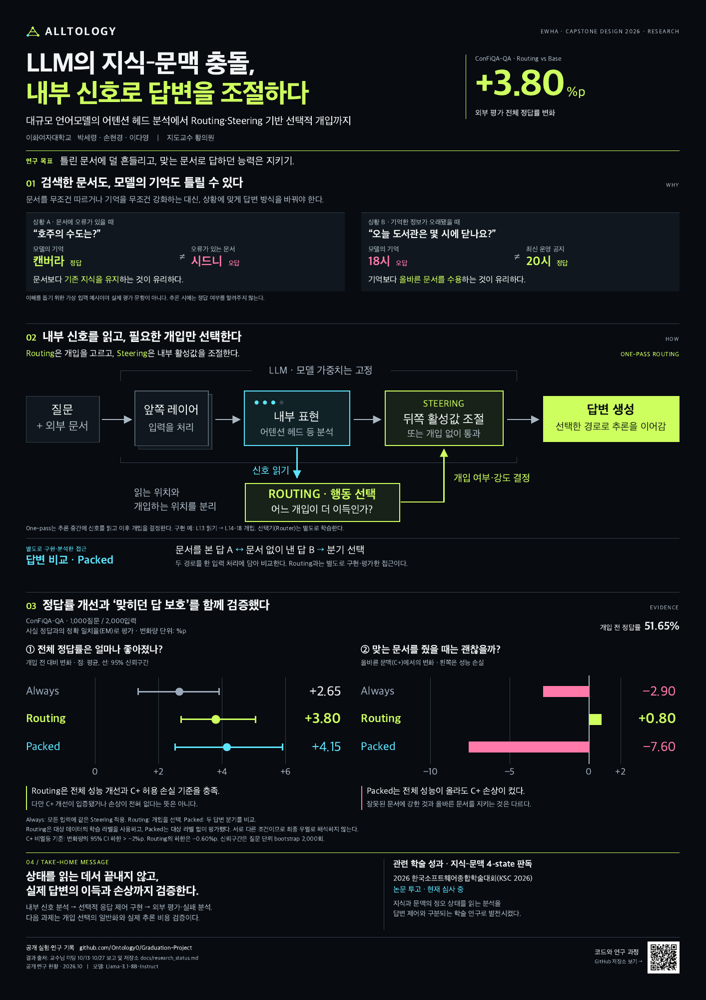

# A1 포스터 초안

2026-10-29 작성. A1 용지 세로형(594 × 841 mm) 기준이며, 수업의 최종 규격·제출 방식은 별도 확인이 필요합니다.

## 파일

현재 검토본은 v2: 검정 바탕·네온 포인트입니다. 처음 보는 독자에게 문제 상황 → 내부 신호와 개입 구조 → 성능 개선과 손실을 순서대로 보여줍니다. 최신 검토본만 저장소에 공개합니다.

- [v2 인쇄용 PDF](v2/Alltology_A1_draft.pdf): A1 한 페이지, 벡터 도형·텍스트.
- [v2 300dpi PNG](v2/Alltology_A1_300dpi.png): 7,016 × 9,933 px.
- [v2 미리보기](v2/Alltology_A1_preview.png).
- [v2 편집 원본](v2/Alltology_A1_draft.html).

[](v2/Alltology_A1_draft.pdf)

## 구성

1. 왜 필요한가: 모델의 기억과 외부 문서 어느 쪽도 항상 정확하지 않음.
2. 어떻게 접근하는가: 내부 신호 → Routing → 선택적 개입·Steering. Packed는 별도 접근으로 구분.
3. 무엇을 관찰했는가: 전체 정답률 개선과 올바른 문맥(C+)의 성능을 두 그래프로 병렬 표시.
4. 무엇을 배웠는가: 상태 판별과 답변 개선을 구별하고, 이득·손상·추론 비용을 함께 평가.
5. 어디까지 진행했는가: 현재 연구 흐름과 별도 4-state 논문의 투고·심사 상태.

## 수치와 공개 범위

[연구 결과 문서](../research_status.md)의 ConFiQA-QA 1,000질문 보고를 사용했습니다. A3의 1,200질문 결과와 합치지 않았습니다.

| 항목 | Always | Router | Packed |
|---|---:|---:|---:|
| 전체 정답률 변화(%p) | +2.65 | +3.80 | +4.15 |
| 전체 변화의 95% CI | [1.35, 3.90] | [2.70, 5.05] | [2.52, 5.90] |
| C+ 정답률 변화(%p) | −2.90 | +0.80 | −7.60 |
| C+ 변화의 95% CI 하한 | −4.50 | −0.60 | −9.50 |

- 기준선 EM은 51.65%입니다. EM은 정규화 후 정답과 답변의 정확 일치율입니다.
- Router는 대상 ConFiQA 학습 fold의 라벨을 사용하고, Packed는 대상 라벨 없이 평가했습니다.
- C+ 비열등 기준은 변화의 95% CI 하한 > −2%p입니다. 충족을 C+ 개선 입증이나 손상 없음으로 표현하지 않았습니다.
- 논문용 상세 수치·코드, 비공개 PDF·채팅 원문은 포함하지 않았습니다.
- 포스터의 QR은 공개 GitHub 저장소로 연결됩니다.

## 재생성

macOS의 Google Chrome, Poppler(`pdftoppm`), Python `qrcode`가 필요합니다. 한국어 글꼴은 Apple SD Gothic Neo를 우선 사용합니다.

```bash
python3 docs/poster/render.py
```

그래프는 보고 수치로 작성한 SVG이며 이미지 생성 모델로 그리지 않았습니다. 렌더러는 패널 넘침을 확인한 뒤 PDF·PNG를 생성합니다. 이 초안은 모델 추론이나 외부 API 실험을 실행하지 않습니다.

## v2 인쇄·내용 참고

- 실제 크기(100%)로 PDF를 인쇄합니다. 검정 바탕은 도련·재단과 흰 테두리 유무를 인쇄소에 확인해야 합니다. 파일 자체는 도련 없는 A1 규격입니다.
- 네온 색은 화면용 RGB 색상입니다. 일반 CMYK 인쇄에서 형광 잉크처럼 발광하는 색을 보장하지 않으므로 시험 인쇄를 권장합니다.
- 두 문제 사례는 가상 입력 예시이며 평가 데이터에서 추출한 사례가 아닙니다.
- 방법 그림의 레이어 위치는 One-pass 구현 예시입니다. 모든 실험의 동일 구조 또는 ConFiQA 결과의 지연 측정을 뜻하지 않습니다.
- Routing과 Packed를 별도 방법으로 표시하며, 결합 결과·논문 게재 승인·무조건적인 정답 보호를 주장하지 않습니다.
- 포스터는 외부 ConFiQA 결과에 집중합니다. P8S 정책 평가는 [연구 결과 문서](../research_status.md#2-p8s-always-steering과-routing)에서 별도로 확인할 수 있습니다.
