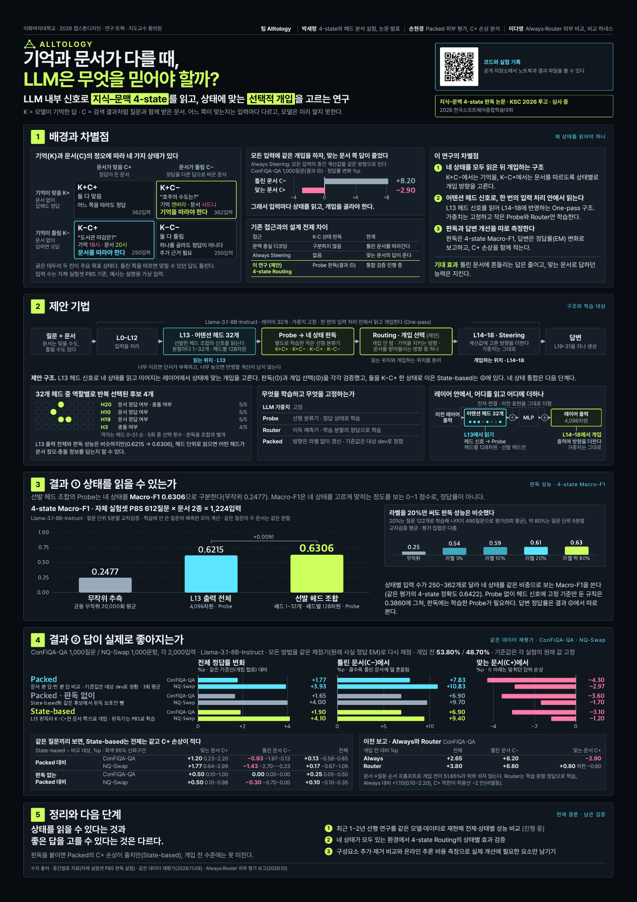

# A1 포스터

A1 용지 세로형(594 × 841 mm) 기준입니다. 수업 일정은 초안 제출 11/9, 최종 인쇄용 PDF 제출 11/13 10:00, 포스터 발표 11/17이며 변경될 수 있습니다.

## 파일

현재 검토본은 v3입니다. 11/03 교수님 면담에서 정한 방향(지식–문맥 4-state 판독과 어텐션 헤드 분석 결과를 중심에 두고, 실험 설정·비교 기준·결과 해석을 명확하게)에 맞춰 v2를 다시 구성했습니다. 최신 검토본만 저장소에 공개합니다.

- [v3 인쇄용 PDF](v3/Alltology_A1_draft.pdf): A1 한 페이지, 벡터 도형·텍스트.
- [v3 300dpi PNG](v3/Alltology_A1_300dpi.png): 7,016 × 9,933 px.
- [v3 미리보기](v3/Alltology_A1_preview.png).
- [v3 편집 원본](v3/Alltology_A1_draft.html)과 [차트 생성 스크립트](v3/tools/charts.py).

[](v3/Alltology_A1_draft.pdf)

이전 검토본 v2(Routing·Packed 외부 평가 중심)는 `v2/`에 남아 있습니다.

## 구성

1. 배경과 차별점: 기억(K)과 문서(C)의 정오로 나뉘는 네 상태를 2×2로 보여 주고, 모든 입력에 같은 개입을 했을 때의 손상(Always), 기존 접근과의 설계 전제 차이, 차별점 세 가지를 둡니다.
2. 제안 기법: 질문+문서 → L0–L12 → L13 어텐션 헤드 신호 → Probe 판독 → Routing(제안) → L14–18 Steering → 답변의 One-pass 구조. 역할별로 반복 선택된 헤드 후보, 학습·고정 대상, 그리고 레이어 하나를 펼쳐 어텐션 헤드 신호를 읽는 곳(L13)과 레이어 출력에 방향을 더하는 곳(L14–18)을 그림으로 둡니다. Packed는 결과 ②의 행 라벨과 학습·고정 표에서 설명합니다.
3. 결과 ① 상태를 읽을 수 있는가: P8S 4-state Macro-F1(무작위 → L13 출력 전체 → 선발 헤드 조합)과 라벨 20% 실험.
4. 결과 ② 답이 실제로 좋아지는가: 2026-11-09 같은 데이터 재평가(공통 기준선)로 Packed · 판독 없는 Packed · State-based를 ConFiQA-QA·NQ-Swap에서 전체·틀린 문서(C−)·맞는 문서(C+) 세 패널로 비교합니다. 아래 왼쪽은 같은 질문끼리 비교한 차이와 95% CI, 오른쪽은 기준선이 다른 이전 보고의 Always·Router입니다.
5. 정리와 다음 단계: 한 문장 결론과 11/03 면담에서 정한 다음 단계.

## 수치와 공개 범위

### 4-state 판독 · 자체 실험셋 P8S(612질문 × 문서 2종 = 1,224입력)

중간발표 자료에 공개한 집계값입니다. 질문 단위 5-fold, Llama-3.1-8B-Instruct.

| 항목 | 4-state Macro-F1 |
|---|---:|
| 균등 무작위(20,000회 평균) | 0.2477 |
| L13 출력 전체 · Probe | 0.6215 |
| 선발 헤드 조합 · Probe (pooled OOF) | 0.6306 |
| 라벨 20%(122질문 학습 / 490질문 평가, 5회 평균) | 0.6120 |

같은 평가의 4-state 정확도는 0.6422, Probe 없이 헤드 신호에 고정 기준만 적용한 규칙은 0.3860입니다. 역할별 반복 선택 헤드 후보는 H20·H10·H19·H3이며, 판독에 실제 쓴 헤드 수는 fold마다 1~32개입니다.

### 결과 ② · 같은 데이터 재평가(ConFiQA-QA 1,000질문, NQ-Swap 1,000 ID · 각 2,000입력)

2026-11-09 재평가 노트북(`APO3재현성E20_D_SameData_Replay_20261109.ipynb`)의 결과 파일 `EM_AND_PRESERVATION.csv`·`PAIRED_DIFFERENCES_CI.csv`(scope `full_fixed_test`) 값입니다. 노트북은 저장된 원래 답변을 같은 질문·문서·정답과 같은 채점기(유니코드 정규화한 전체 답변 EM, 원래 사실 정답 기준)로 다시 채점하며, 과거 요약 수치를 다시 붙이지 말고 이 출력만 쓰라고 명시합니다.

| 포스터 이름 | 노트북 이름 | 내용 |
|---|---|---|
| Packed | `A6_PO3` | 질문→문서 프롬프트, Packed R1 + 온라인 steering, 저장 생성 3회(seed 0·1·2) 평균. 분기 기준값 τ≈6.34는 원래 대상 dev에서 정함 |
| Packed · 판독 없이 | `E20_A_Packed` | E20 v5 후보의 Packed R1(τ=5.32 고정) |
| State-based | `E20_D` | 같은 E20 후보에서, L13 헤드 판독기(E17)가 K−C+로 읽은 입력은 문서 수용 방향(E19 Accept)으로 L14–18에 개입한 답을 씀 |

공통 기준선(개입 없음, `E20_Base`) 대비 변화(%p):

| | ConFiQA-QA 전체 | C− | C+ | NQ-Swap 전체 | C− | C+ |
|---|---:|---:|---:|---:|---:|---:|
| 개입 없음 EM | 53.80 | 32.00 | 75.60 | 48.70 | 23.40 | 74.00 |
| Packed | +1.77 | +7.83 | −4.30 | +3.93 | +10.83 | −2.97 |
| Packed · 판독 없이 | +1.65 | +6.90 | −3.60 | +4.00 | +9.70 | −1.70 |
| State-based | +1.90 | +6.90 | −3.10 | +4.10 | +9.40 | −1.20 |

같은 질문끼리 비교한 차이(State-based − 비교 대상, %p, 질문 단위 대응 bootstrap 2,000회 95% CI):

| 비교 | 데이터 | C+ | C− | 전체 | K−C+ |
|---|---|---:|---:|---:|---:|
| Packed 대비 | ConFiQA-QA | +1.20 [0.23, 2.20] | −0.93 [−1.97, 0.13] | +0.13 [−0.58, 0.85] | +1.61 [0.06, 3.38] |
| Packed 대비 | NQ-Swap | +1.77 [0.64, 2.99] | −1.43 [−2.70, −0.23] | +0.17 [−0.67, 1.05] | +2.58 [0.86, 4.40] |
| 판독 없는 Packed 대비 | ConFiQA-QA | +0.50 [0.10, 1.00] | 0.00 [0.00, 0.00] | +0.25 [0.05, 0.50] | +0.83 [0.17, 1.66] |
| 판독 없는 Packed 대비 | NQ-Swap | +0.50 [0.10, 0.98] | −0.30 [−0.70, 0.00] | +0.10 [−0.10, 0.35] | +0.76 [0.15, 1.40] |

- Packed 대비 C+ 차이(+1.20, +1.77)에는 생성 실행 차이(Packed와 판독 없는 Packed 사이)와 판독 보호 효과(+0.50)가 함께 들어 있습니다. 4-state 판독만의 효과는 판독 없는 Packed 대비 행으로 읽습니다.
- E17 판독기와 E19 Accept 방향은 자체 실험셋 P8S로 학습했습니다. 각 방법의 τ는 원래 실험값을 고정했고 재평가에서 다시 맞추지 않았습니다. 노트북은 이 비교를 "두 방법 모두 대상 데이터 라벨 0개"라고 주장하지 않습니다.
- K−C+는 같은 엔진의 문서 없는 답(standalone closed-book)이 틀린 C+ 입력입니다(ConFiQA-QA 602, NQ-Swap 659입력). NQ-Swap 1,000 ID의 고유 질문은 869개이며 CI는 질문 단위로 묶었습니다.
- CI는 저장된 생성 결과에 조건부인 질문 표본 불확실성이며, 생성 seed 변동 전체를 반영하지 않습니다.
- 포스터는 이 결과를 "State-based는 전체 정답률은 같고 C+ 손상이 적지만, 개입 전 수준에는 못 미친다"로만 해석합니다.

### 이전 보고 · Always와 Router(ConFiQA-QA 1,000질문 / 2,000입력)

[연구 결과 문서](../research_status.md)의 보고값입니다. 기준선 EM 51.65%는 재평가 결과 파일의 `A6_A_CQ`(문서→질문 순서 프롬프트, 개입 없음)와 같은 값이라, 위 재평가와 프롬프트·기준선이 다릅니다. 포스터에서는 두 결과를 한 차트에 넣지 않습니다.

| 항목 | Always | Router |
|---|---:|---:|
| 전체 정답률 변화(%p) | +2.65 [1.35, 3.90] | +3.80 [2.70, 5.05] |
| C− 정답률 변화(%p) | +8.20 | +6.80 |
| C+ 정답률 변화(%p) | −2.90 | +0.80 |
| C+ 변화의 95% CI 하한 | −4.50 | −0.60 |

- Router는 대상 ConFiQA train fold의 라벨로 이득 예측기를 학습했습니다. Router − Always는 +1.15%p [0.10, 2.20]입니다.
- C+ 비열등 기준은 변화의 95% CI 하한 > −2%p이며 Router가 충족합니다. 충족을 C+ 개선 입증으로 표현하지 않았습니다.
- 같은 보고의 Packed 값(전체 +4.15, C+ −7.60)은 포스터에서 위 같은 데이터 재평가로 대체했습니다.

### 그 밖의 주의

- 추론 비용은 포스터에서 뺐습니다. 있는 값은 Packed 개발 실험의 P8S 측정값(지연 1.09배, prefill 토큰 약 39% 증가)뿐이고 외부 평가에서 재측정하지 않았으며, Router는 미측정입니다. 온라인 추론 비용 측정은 다음 단계 ③에 둡니다.
- 포스터의 'Routing'은 제안 구조, 'Router'는 평가한 구현을 가리킵니다. 4-state 판독을 개입에 붙인 결과는 State-based(K−C+ 한 상태)뿐이며, 네 상태를 모두 쓰는 Routing의 통합 결과는 아직 없습니다.
- 지식–문맥 4-state 판독 논문은 KSC 2026에 투고해 심사 중입니다. 논문용 상세 수치·코드는 포함하지 않았고, 포스터의 판독 수치는 중간발표에서 이미 공개한 집계값만 썼습니다. 같은 데이터 재평가 수치는 중간발표 이후의 새 결과입니다.
- 포스터의 QR은 공개 GitHub 저장소로 연결됩니다.

## 재생성

macOS의 Google Chrome, Poppler(`pdftoppm`), Python `qrcode`가 필요합니다. 글꼴은 `v3/assets/`의 Pretendard(OFL)를 사용하고 Apple SD Gothic Neo로 대체합니다.

```bash
python3 docs/poster/v3/tools/charts.py          # 차트 SVG 4개 생성
uv run --with qrcode --with pillow python docs/poster/render.py --directory docs/poster/v3
```

차트는 보고 수치로 작성한 SVG이며 이미지 생성 모델로 그리지 않았습니다. 렌더러는 블록별 넘침을 확인한 뒤 PDF·PNG를 생성합니다. 모델 추론이나 외부 API 실험은 실행하지 않습니다.

## 인쇄·내용 참고

- 글자 크기는 LaTeX 포스터 패키지 beamerposter의 A1 배율(A0 대비 0.7071)과 Gemini 테마의 역할 배정을 기준으로 맞췄습니다. 본문 17pt, 보조 설명·차트 축 14–15pt이며, 13pt는 출처 줄에만 씁니다.

- 실제 크기(100%)로 PDF를 인쇄합니다. 검정 바탕은 도련·재단과 흰 테두리 유무를 인쇄소에 확인해야 합니다. 파일 자체는 도련 없는 A1 규격입니다.
- 네온 색은 화면용 RGB 색상입니다. 일반 CMYK 인쇄에서 형광 잉크처럼 발광하는 색을 보장하지 않으므로 시험 인쇄를 권장합니다.
- 상태 설명의 두 예시(호주의 수도, 도서관 마감)는 가상 입력이며 평가 데이터에서 추출한 사례가 아닙니다.
- 구조도의 레이어 위치(L13 읽기, L14–18 개입)는 One-pass 구현 예시입니다. 모든 실험이 같은 구조라는 뜻은 아닙니다.
- 기존 접근 비교표는 설계 전제의 차이만 나타냅니다. 같은 모델·데이터에서의 성능 비교는 진행 중입니다.
