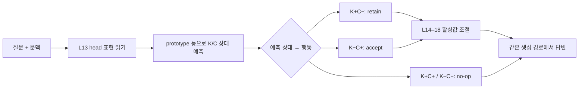

# 4state-base — 상태 판독에서 실제 답변 제어까지

> 연구·실험: 박세령. 2026-11-01에 상태 기반 연구 코드를 별도 폴더로 모았습니다. 이번 작업에서 모델을 재실행하지 않았으며, 논문 심사용 코드·저장 출력·상세 결과를 새로 공개하지 않습니다.

## 무엇부터 볼까?

상태 기반 Routing은 단순히 K/C를 분류하는 것에서 끝나지 않습니다. 예측한 상태 또는 행동별 이득을 이용해 개입 여부·방향·강도를 정하고, 실제 생성된 답이 좋아지는지를 평가합니다. 박세령의 이 연구 흐름을 한곳에서 확인할 수 있도록 핵심 노트북 5개를 이 폴더에 직접 포함합니다.

기존 `presentation/`에도 같은 코드가 있지만, 기존 링크를 깨지 않도록 보존합니다. 이 폴더는 상태 기반 연구를 읽고 이어가기 위한 별도 묶음이며, 다른 팀원의 Routing·Packed 실험 전체를 박세령의 작업으로 묶는 것은 아닙니다.

| 순서 | 연구 질문 | 코드 | 확인할 범위 |
|---|---|---|---|
| 1 | 상태별로 다른 행동을 하면 실제 답이 달라지는가? | [E17 FixedGeometry](E17_FixedGeometry_5Fold.ipynb) | `prototype__state_map`, `prototype__budget`, `e14_rule`, `noop`의 실제 QA 비교; outer 5-fold |
| 2 | 상태→행동 규칙 대신 행동별 이득을 예측하면 어떤가? | [E15 Online Utility Router](E15_Online_StrongRetain_UtilityRouter.ipynb) | 실제 forward 중 행동·강도 선택 후 생성; 저장된 최종 test는 Fold 0 |
| 3 | 상태를 읽는 head와 특징은 어디서 왔는가? | [E14 + router metrics](E14_L13_HeadDissection_5Fold_plus_router_metrics.ipynb) | head 선별, 상태 판독, 실제 gate의 성능을 나누어 확인 |
| 4 | K와 C를 읽는 위치·층을 바꾸면 어떤가? | [E18A](E18A_EarlyK_LateC_4State_5Fold.ipynb) | 상태 판독 진단; 답변 생성·Steering 성능 실험은 아님 |
| 5 | C 판독은 고정하고 여러 층으로 K를 읽으면 어떤가? | [E18B](E18B_Readable_5Fold.ipynb) | 같은 분할·차원 예산의 판독 비교; QA 개선을 입증하지 않음 |

E13의 구성요소 분석과 E16의 소량 라벨 실험은 [전체 발표 코드 목록](../presentation/README.md)에 보존합니다. 위 순서는 읽는 순서이며, 모든 노트북을 순서대로 실행하는 파이프라인은 아닙니다.

## E17: 상태를 읽고 행동을 정하는 경로

- K는 문맥 없는 답변을 기준으로 만든 행동 라벨입니다. 이 계열은 `kside_corr`를 사용하며, K+를 모델이 실제로 안다는 절대적 판정으로 해석하지 않습니다.
- C는 문맥의 정오 구분입니다. 추론 중에는 정답 K/C를 주지 않고 내부 표현에서 상태를 예측합니다.
- `retain`은 기존 지식을 유지하는 방향, `accept`는 문맥을 수용하는 방향의 개입입니다. 어느 쪽도 정답을 보장하지 않습니다.
- `prototype`은 학습 구간의 상태별 대표 벡터와 비교하는 판독기입니다. 별도의 LR 최적화가 없더라도 라벨로 대표 벡터를 만들므로 완전 label-free 방식이 아닙니다.

### state_map과 budget은 다른 정책

| 조건 | 의미 | 비교할 때 주의할 점 |
|---|---|---|
| `noop` | 같은 실행 엔진으로 개입 없이 답변 생성 | 별도 실험의 base 대신 이 값을 기준으로 사용 |
| `e14_rule` | E14 규칙을 E17 엔진에서 재실행 | 과거 E14 저장 결과와 동일하다고 가정하지 않음 |
| `prototype__budget` | prototype 판독 뒤 margin·개입률 제한을 추가 | 기존 gate와 비슷한 개입 예산에서 비교하려는 조건 |
| `prototype__state_map` | 예측 상태가 retain/accept이면 추가 budget 제한 없이 개입 | 전 입력 강제 개입이 아님; budget 조건과 개입률이 다름 |
| `prototype__budget_random_steer` | budget 경로의 선택은 유지하고 개입 방향을 무작위화 | 선택 규칙과 Steering 방향의 기여를 구분 |

`prototype__state_map`의 개선을 곧바로 판독기만의 개선으로 해석하면 안 됩니다. 추가 제한을 풀어 개입률도 바뀌므로, Recovery·Damage·개입률을 함께 봐야 합니다. 주 QA 비교인 `prototype__budget` 대 `e14_rule`과 별도 ablation인 `prototype__state_map`도 구분합니다.

노트북 끝의 `direction__state_map`은 추가 구현입니다. 확인한 Drive 원본에서는 이 확장 셀의 저장 출력을 찾지 못했으므로, 코드 존재만으로 실행 완료로 표시하지 않습니다.

## E15: 상태보다 행동의 이득을 직접 예측하는 경로

[E15 Online Utility Router](E15_Online_StrongRetain_UtilityRouter.ipynb)는 `L13 hidden + probe 출력 → 행동별 예상 이득·회복·손상 → 방향·강도 선택 → 실제 생성`을 구현합니다. 최종 test에서 저장된 정답 행동 결과를 골라 붙이는 방식이 아닙니다.

- 개발 구간에서는 여러 행동을 실제 실행해 학습용 outcome bank를 만듭니다.
- 질문 단위 OOF 예측으로 정책을 고르고, `POLICY_LOCK.json`을 저장한 뒤 test에 적용합니다.
- 내부 utility 학습의 5-fold와 최종 QA 평가의 outer fold를 혼동하지 않습니다. 확인한 최종 QA 결과는 Fold 0입니다.
- [A1](../A1/A1_staged_routing.ipynb)은 저장된 행동 결과를 이용한 정책 평가입니다. E15와 입력 순서·행동 구성·baseline도 달라 raw EM만으로 순위를 매기지 않습니다.

E17의 상태→행동 규칙과 E15의 이득 예측은 서로 다른 설계입니다. 둘을 같은 입력·분할·actuator로 비교하는 것은 후속 과제이며, 현재 결과를 이미 완료된 동일 조건 비교로 합치지 않습니다.

## 상태 판독 점수와 답변 점수 구분

| 지표 | 답하는 질문 |
|---|---|
| 상태 Macro-F1·K/C AUROC | 내부 표현에서 상태를 얼마나 잘 구분하는가? |
| QA EM | 생성한 답이 정규화·정답 별칭 처리를 거쳐 gold와 일치하는가? |
| Recovery / Damage | 개입 전 오답을 몇 행 고쳤고, 정답을 몇 행 잃었는가? |
| Net Gain | `Recovery − Damage`는 얼마인가? |
| C+ 성능·신뢰구간 | 올바른 문맥에서의 손상을 별도로 통제하는가? |
| 개입률·지연시간 | 얼마나 자주 개입하고 실제 비용은 얼마인가? |

E17의 평가 입력은 P8S 612질문의 C+/C− 쌍, 총 1,224행입니다. 서로 독립적인 질문 1,224개가 아니며, 같은 질문 쌍을 유지한 분할·bootstrap이 필요합니다. 기존 결과를 본 뒤 설계한 개발셋 후속 비교이므로 외부 일반화나 완전히 새로운 blind test로 표현하지 않습니다.

E18A·B는 판독 진단입니다. 점 추정치 상승만으로 채택하거나 QA 개선으로 연결하지 않고, 사전 비교·신뢰구간·상태별 오류를 확인해야 합니다. 특히 E18B의 Q9·Q13·Q17·Q21·Q25 정보를 전부 읽은 뒤 같은 forward의 L14–18로 돌아가 개입할 수는 없습니다. 실제 Router에 연결할 때는 판독 시점과 그 이후 개입 위치를 다시 설계해야 합니다.

## 실행 전에 필요한 것

| 코드 | 주요 입력·점검 |
|---|---|
| E17 | `CFG["E14_ROOT"]` 아래 `L13_neutral_head_bank_all_rows.npz`와 fold별 `split_manifest.csv`, `HEAD_LABELFREE_POLICY_LOCK.json`, `instruction_vectors.npz`; 데이터·라벨·모델 revision 검증 |
| E15 | E11 Fold 0 split·중립 hidden·detector·vector, E13 binary probe, P8S 데이터·라벨; 입력 경로와 모델 접근 권한 |
| E18A·B | 원본 특징·라벨·질문 단위 분할 및 기준 결과; cache 검증, 미수집 특징이 있을 때 GPU |

E17은 먼저 `RUN_GENERATION=False`로 판독·입력 검증을 확인할 수 있습니다. 실제 QA는 `RUN_GENERATION=True`와 GPU·모델 접근 권한이 필요합니다. 노트북만 복사해도 대형 activation bank가 따라오는 것은 아닙니다. 기존 원본을 덮어쓰지 말고, 설정이 달라지면 새 run ID와 결과 경로를 사용합니다.

생성 후 확인할 E17 산출물은 `QA_OOF_SUMMARY.csv`, `QA_PAIRED_VS_E14.csv`, `QA_LIVE_STATE_METRICS.csv`, `QA_LIVE_VS_BANK_ACTION_AUDIT.csv`입니다. bank에서 계산한 선택과 live 선택이 다르면 실제 QA 해석에는 live 기록을 우선합니다. 이 파일명은 실행 산출물 안내이며, 해당 결과 파일을 이번 커밋에 포함했다는 뜻은 아닙니다.

## Packed·논문과의 구분

- 이 문서의 [E17 FixedGeometry](E17_FixedGeometry_5Fold.ipynb)는 [E17 Packed](../E17/E17_packed.ipynb)와 별개입니다. 번호가 같아도 합치지 않습니다.
- 이 문서의 [E15 Online Utility Router](E15_Online_StrongRetain_UtilityRouter.ipynb)는 [E15 C-proxy gate](../E15/E15_cproxy_gate.ipynb)와 별개입니다.
- Packed의 X1은 문맥/closed-book 분기 선택이고, 위 상태 기반 Router는 개입 행동 선택입니다. 확신도 기반 분기 선택을 반드시 채택해야 상태 기반 연구를 이어갈 수 있는 것은 아닙니다.
- 공개본은 코드와 원문 설명을 보존하고 실행 출력·실행자 메타데이터를 제거한 버전입니다. 출력이 비어 있다는 이유만으로 원본도 미실행이라고 판단하지 않습니다. 원문 설명과 저장 출력의 작성 시점도 구분합니다.
- 복사 출처·Drive 원본·파일 해시는 [출처 기록](sources.json)에 있습니다. E15·E17·E18A·E18B는 확인한 Drive 원본과 코드·Markdown 셀 소스가 일치하며, E14는 기존 공개본을 복사했습니다. 이후 수정 시 이 기록의 복사 시점과 새 실행 버전을 구분합니다.
- 심사 중 논문의 코드·상세 결과 공개 보류는 유지합니다. 제출 논문 전체나 비공개 원문을 이 안내에 첨부하지 않습니다.

[전체 발표 코드](../presentation/README.md) · [실험 지도](../README.md) · [연구 결과와 한계](../../docs/research_status.md)
